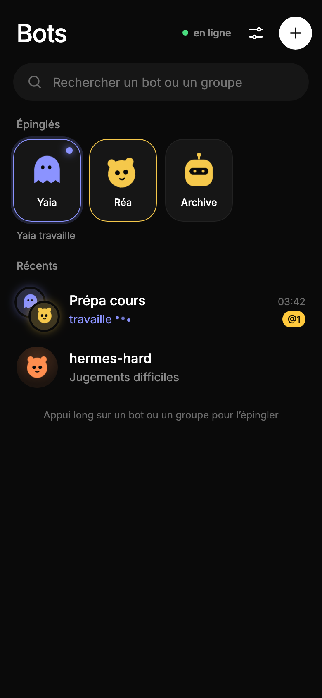
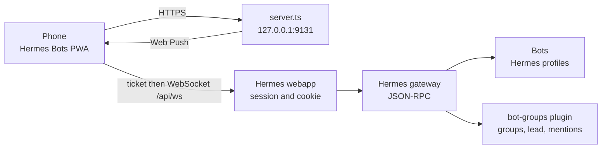

<div align="center">

[](README.md)


# Hermes Bots

**Drive your AI agents from your phone.**<br>
An open source PWA for [Hermes Agent](https://github.com/NousResearch/hermes-agent): your bots, each one's permanent chat, bot groups, command approvals and notifications.

[](LICENSE)
[](package.json)
[](web/src)
[](server.ts)
[](#security)

</div>

<p align="center"></p>

## Why

Hermes Agent runs capable agents, but you drive them from a terminal or a desktop-first webapp. Away from your desk, approving a command, restarting a bot or following a bot group is a chore.

Hermes Bots is the phone layer: an installable app, fast on 20,000-message conversations, readable offline. The code is yours and runs on your own machine.

> **Beta.** No support promised. Issues are read; feature requests are not commitments. The interface is in French.

## How it works



1. `server.ts` serves the app and sends Web Push notifications.
2. The app signs in with the Hermes webapp session, takes a ticket (`POST /api/webapp/socket-ticket`), then speaks the gateway's JSON-RPC over `/api/ws`.
3. The `plugins/bot-groups` plugin adds bot groups to the gateway: a lead that splits the work, tasks, and mentions that notify you.

What the interface does:

- One permanent chat per bot, live text, collapsible tool lines.
- Approve a command from your phone.
- Bot groups with a lead and a task board.
- Scheduled jobs per bot: next run, state, pause.
- Per-device Web Push notifications, priority mention when a bot needs you.
- Offline cache: a conversation you already opened reads without network.

## Requirements

- [Bun](https://bun.sh) 1.2 or newer.
- For real use: a [Hermes Agent](https://github.com/NousResearch/hermes-agent) with its webapp and gateway.
- For browser tests: `bunx playwright-core install chromium-headless-shell`.

## Installation

Two-minute trial, no Hermes needed, on a fake gateway that simulates bots:

```sh
git clone https://github.com/pyxl-dev/hermes-bots
cd hermes-bots
bun install
bun run build
bun test/mock-gateway.ts      # http://127.0.0.1:8790/bots/
```

For real: `bun server.ts` serves the app on `127.0.0.1:9131`. Put it behind the same host name as your Hermes webapp (reverse proxy or tailnet) and set that origin in `PWA_URL`. Copy `plugins/bot-groups` into Hermes's plugins for groups.

**Let your AI agent handle it:** give it this repo and ask it to "install Hermes Bots in front of my Hermes following the README and docs/MAINTENANCE.md".

## Settings

Every value has a local default; nothing is required to try it.

| Variable | Default | Role |
| --- | --- | --- |
| `HERMES_GATEWAY` | `http://127.0.0.1:9120` | Origin of the Hermes webapp and gateway |
| `PWA_URL` | `http://127.0.0.1:9131/bots/` | Public origin of the app, used in notifications |
| `PWA_SERVICE` | none | launchd service restarted when `server.ts` changes on release |
| `PROD_ORIGIN` | `http://127.0.0.1:9131` | Origin targeted by `test/real-journey.ts --target prod` |

## Security

- The app stores no password: it reuses the Hermes webapp session, and each socket takes a ticket from the webapp.
- `server.ts` listens on `127.0.0.1` only. Exposing it goes through your reverse proxy or tailnet, over HTTPS.
- Web Push (VAPID) keys are generated on your machine and stay out of the repo.
- Report vulnerabilities privately: see [SECURITY.md](SECURITY.md).

## Development

```sh
bun run dev              # SolidJS client with hot reload
bun test/smoke.ts        # full journeys in Chromium on the fake gateway (about 30 s)
bun run typecheck        # client types
bun run check            # gateway RPC contracts
```

Git hooks live in `.githooks/` (installed by `bun install`) and CI replays them. Internal documentation (release, test gateway, real journeys, plugin) is in [docs/MAINTENANCE.md](docs/MAINTENANCE.md), in French.

This repo is the public version of a private working repo, synced automatically on every release.

## License

[MIT](LICENSE). Made with Claude.
