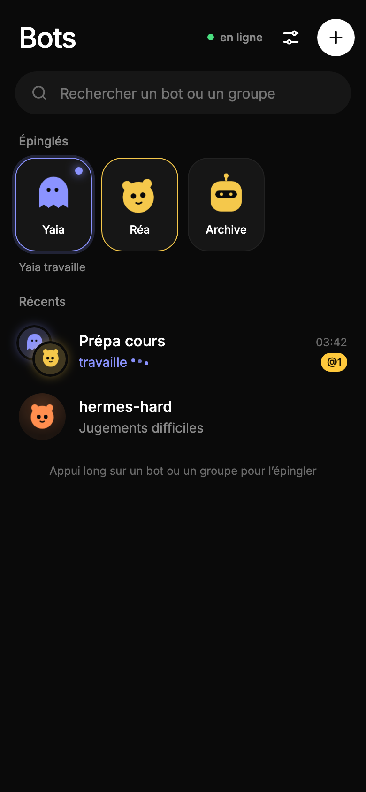
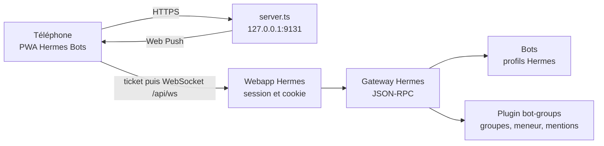

<div align="center">

[](README.en.md)


# Hermes Bots

**Pilote tes agents IA depuis ton téléphone.**<br>
Une PWA open source pour [Hermes Agent](https://github.com/NousResearch/hermes-agent) : la liste de tes bots, le chat permanent de chacun, les groupes de bots, les validations de commandes et les notifications.

[](LICENSE)
[](package.json)
[](web/src)
[](server.ts)
[](#sécurité)

</div>

<p align="center"></p>

## Pourquoi

Hermes Agent fait tourner des agents puissants, mais on les pilote depuis un terminal ou une webapp pensée pour l'ordinateur. Dès qu'on est loin du bureau, valider une commande, relancer un bot ou suivre un groupe de bots devient pénible.

Hermes Bots est la couche téléphone : une app installable, rapide sur des conversations de 20 000 messages, qui se relit hors ligne. Le code est à toi, tu l'héberges chez toi.

> **Bêta.** Aucun support promis. Les issues sont lues, les demandes de fonctionnalité ne sont pas des engagements.

## Comment ça marche



1. `server.ts` sert l'app et envoie les notifications Web Push.
2. L'app s'authentifie avec la session de la webapp Hermes, prend un ticket (`POST /api/webapp/socket-ticket`) puis parle le JSON-RPC du gateway sur `/api/ws`.
3. Le plugin `plugins/bot-groups` ajoute au gateway les groupes de bots : un meneur qui répartit le travail, des tâches, des mentions qui te notifient.

Ce que fait l'interface :

- Un chat permanent par bot, texte en direct, lignes d'outils repliables.
- Validation d'une commande depuis le téléphone.
- Groupes de bots avec meneur, tableau de tâches.
- Tâches planifiées par bot : prochaine exécution, état, pause.
- Notifications Web Push par appareil, mention prioritaire quand un bot a besoin de toi.
- Cache hors ligne : une conversation déjà ouverte se relit sans réseau.

## Prérequis

- [Bun](https://bun.sh) 1.2 ou plus récent.
- Pour l'usage réel : un [Hermes Agent](https://github.com/NousResearch/hermes-agent) avec sa webapp et son gateway.
- Pour les tests navigateur : `bunx playwright-core install chromium-headless-shell`.

## Installation

Essai en deux minutes, sans Hermes, sur une passerelle factice qui simule des bots :

```sh
git clone https://github.com/pyxl-dev/hermes-bots
cd hermes-bots
bun install
bun run build
bun test/mock-gateway.ts      # http://127.0.0.1:8790/bots/
```

Pour de vrai : `bun server.ts` sert l'app sur `127.0.0.1:9131`. Mets-la derrière le même nom d'hôte que ta webapp Hermes (reverse proxy ou tailnet) et déclare cette origine dans `PWA_URL`. Copie `plugins/bot-groups` dans les plugins de Hermes pour les groupes.

**Laisse ton agent IA s'en occuper :** donne-lui ce dépôt et demande-lui « installe Hermes Bots devant mon Hermes en suivant le README et docs/MAINTENANCE.md ».

## Réglages

Toutes les valeurs ont un défaut local, rien n'est obligatoire pour essayer. Chacune se pose en variable d'environnement, ou dans `~/.config/hermes-bots/config.json` (clés `pwaUrl`, `pwaService`, `prodOrigin`), hors du dépôt.

| Variable | Défaut | Rôle |
| --- | --- | --- |
| `HERMES_GATEWAY` | `http://127.0.0.1:9120` | Origine de la webapp et du gateway Hermes |
| `PWA_URL` | `http://127.0.0.1:9131/bots/` | Origine publique de l'app, utilisée dans les notifications |
| `PWA_SERVICE` | aucun | Service launchd à relancer quand `server.ts` change à la livraison |
| `PROD_ORIGIN` | `http://127.0.0.1:9131` | Origine visée par `test/real-journey.ts --target prod` |

## Sécurité

- L'app ne stocke aucun mot de passe : elle réutilise la session de la webapp Hermes, et chaque socket prend un ticket auprès de la webapp.
- `server.ts` écoute sur `127.0.0.1` seulement. L'exposer passe par ton reverse proxy ou ton tailnet, avec HTTPS.
- Les clés Web Push (VAPID) sont générées chez toi et restent hors du dépôt.
- Une faille se signale en privé : voir [SECURITY.md](SECURITY.md).

## Développement

```sh
bun run dev              # client SolidJS avec rechargement
bun test/smoke.ts        # parcours complets dans Chromium, sur la passerelle factice (environ 30 s)
bun run typecheck        # types du client
bun run check            # contrats RPC du gateway
```

Hooks git dans `.githooks/` (installés par `bun install`), rejoués par la CI. La documentation interne (livraison, gateway de test, parcours réels, plugin) est dans [docs/MAINTENANCE.md](docs/MAINTENANCE.md).

## Licence

[MIT](LICENSE). Créé avec Claude.
